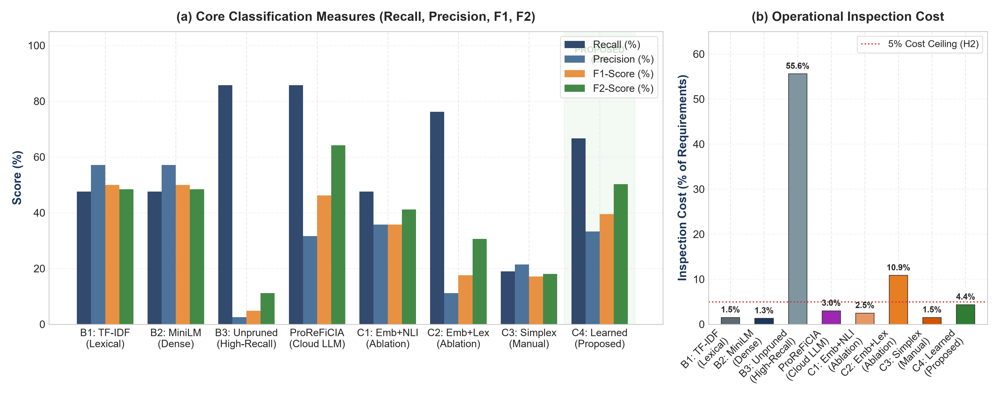
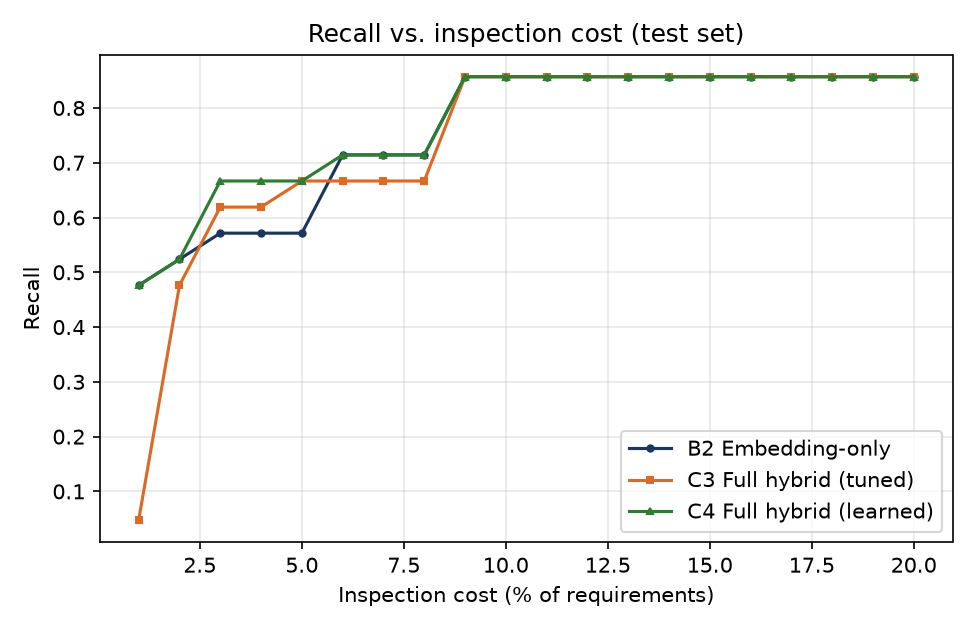
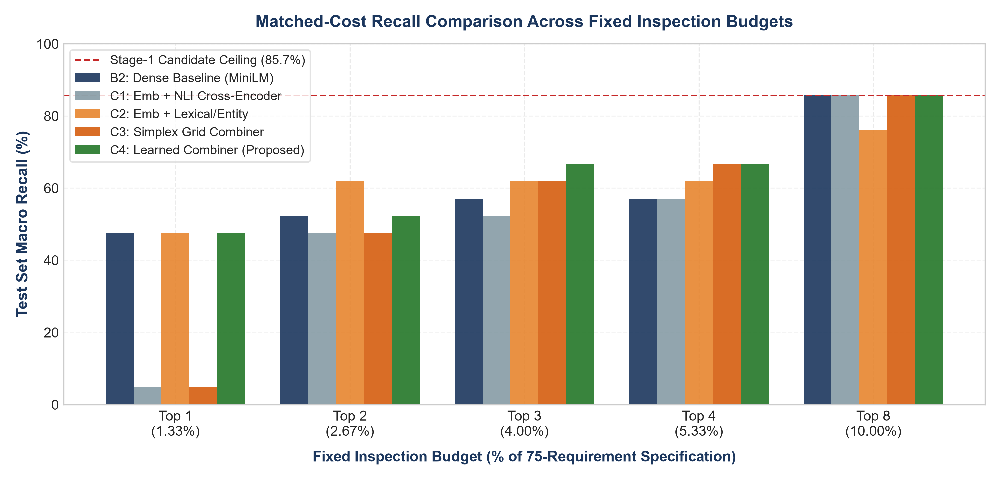
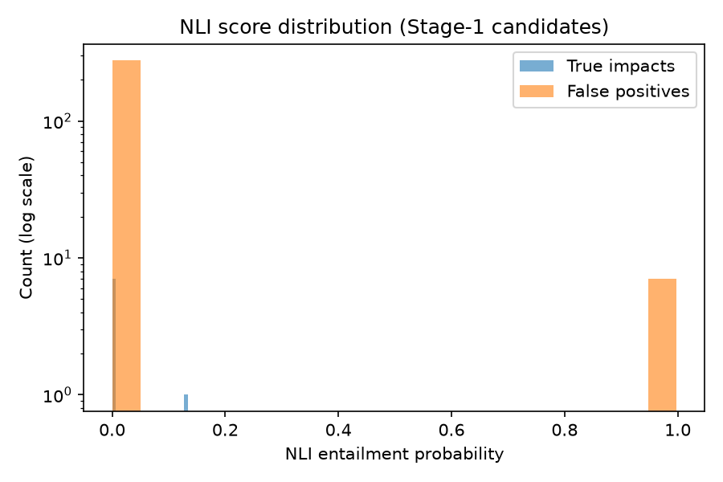
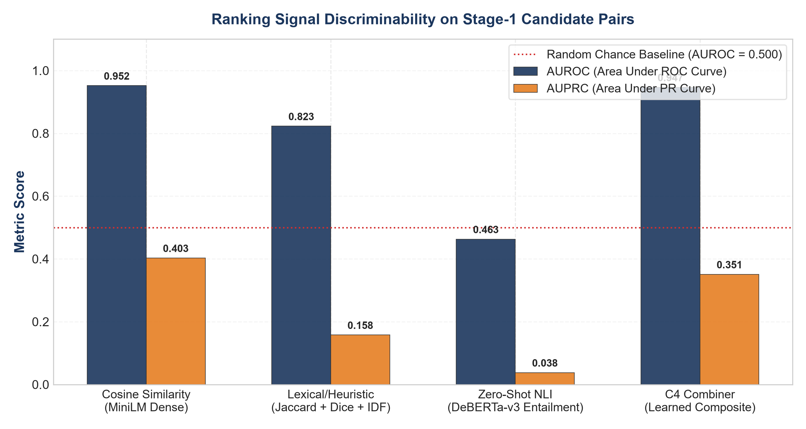
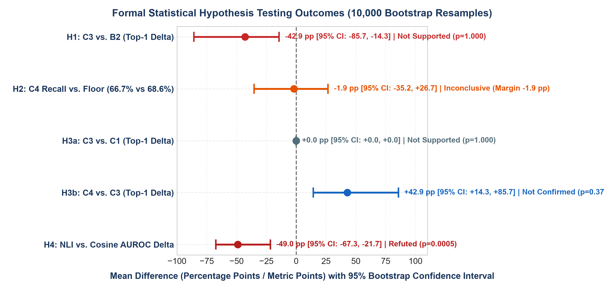

# AI-Based Software Requirements Change Impact Analysis

## A Hybrid Semantic and NLI-Based Approach

**Problem-Based Learning (PBL) Research Project**  
*BS Computer Science — 3rd Semester*  

**GROUP C: 2 MEMBERS**  
**Students:** Abdul Rafay Akhtar, Madeeha (Roll No: F25605217, F25605206)  
**Supervisor / Instructor:** Tayyaba Kulsoom  
**Code Repository:** [GitHub link]  
**Date:** October 2026  

---

### Abstract

Software requirements change frequently throughout the software development lifecycle, and manually identifying which existing requirements are affected by a proposed change—termed Change Impact Analysis (CIA)—is notoriously labor-intensive, error-prone, and unsustainable as system scale expands. Recent state-of-the-art Large Language Model (LLM) approaches, such as ProReFiCIA, achieve high recall (85.7% to 95.8%) but rely on paid, cloud-hosted API infrastructures that present recurring token costs and data exposure risks for proprietary, regulated software domains. Conversely, published semantic embedding baselines (such as Gemini-001 with dynamic drop cutoffs) achieved only 51.7% recall at 2.2% inspection cost. This study investigates whether a lightweight, fully local, two-stage neural pipeline can provide a viable, zero-cost alternative without external cloud dependencies. In Stage 1, a Sentence-BERT (all-MiniLM-L6-v2) bi-encoder retrieves a deliberately high-recall candidate set using a validation-calibrated cosine similarity threshold (tau = 0.225). In Stage 2, candidates are scored and filtered using a zero-shot DeBERTa-v3 Natural Language Inference (NLI) cross-encoder, three lexical/heuristic features, and an L2-regularized logistic-regression combiner. Seven configurations—three baselines (B1–B3) and four hybrid variants (C1–C4)—were evaluated on an open benchmark derived from the Apache Archiva repository comprising 75 requirements and 35 change requests (2,620 evaluated pairs after excluding trivial self-matches). All metrics retain the complete change-request-by-requirement evaluation universe. Our empirical results demonstrate that Stage-1 candidate retrieval reached 92.9% recall on the validation set at tau = 0.225, successfully satisfying the 90.0% feasibility target (H1a). At its operating threshold, C4 reached 66.7% recall and 33.3% precision (F1 = 39.5%, F2 = 50.2%) at 4.38% inspection cost, versus 47.6% recall and 57.1% precision (F1 = 50.0%) for B2 at 1.33% cost. At matched budgets the gain is smaller: at the 4.0% budget C4 reached 66.7% against B2's 57.1% (+9.5 pp). Both methods reached 85.7% recall when inspecting the top 8 requirements (10.0% budget). Zero-shot NLI alone was close to chance (AUROC 0.463 vs. 0.952 for cosine similarity). In an exploratory post-hoc diagnosis on a single pair (MRM-1050->MRM-1068), annotating the true impact with component context ('Redback') raised cosine similarity from 0.141 to 0.438 and its rank from 37 to 2. This lifted top-7 recall (9.33% inspection budget) on the test set to 100%, but only the true impact was annotated, so this is an upper-bound illustration, not a validated result. Synthesizing evidence across 15 related studies (R1-R15), this paper provides a transparent, reproducible comparison demonstrating that local neural retrieval offers an effective, privacy-preserving foundation for automated requirements change management.

**Keywords:** *requirements engineering; change impact analysis; natural language inference; Sentence-BERT; semantic similarity; hybrid re-ranking; software requirements specification; machine learning for requirements engineering; local AI; traceability link recovery*

---

## 1. Introduction

### 1.1 Background

Requirements form the operational foundation of every software engineering endeavor, capturing user expectations, functional boundaries, regulatory compliance standards, and architectural design parameters [1], [15]. Yet, within contemporary software engineering practice, requirements rarely remain static. Market demands fluctuate, business strategies pivot, defect fixes necessitate architectural refactorings, and newly enacted regulatory policies impose strict constraints [8], [10]. As a direct consequence, software engineering artifacts exist in a state of continuous evolution. Whenever a single requirement is modified, added, or retired, the modification can trigger a cascading ripple effect across functionally and architecturally related requirements that were never directly targeted by the original change request [2], [14]. The disciplined engineering activity of systematically determining which artifacts across a system are affected by a given modification is known as Change Impact Analysis (CIA) [1], [4]. In modern requirements engineering, CIA serves as the fundamental gateway for change control boards, product managers, and software architects to evaluate cost, schedule feasibility, and defect risk before approving a modification into active production [3], [9].

### 1.2 The Problem

Despite decades of methodological maturation, CIA in real-world industrial settings is still predominantly conducted through manual expert inspection [3], [4]. An engineer or requirements analyst receives an incoming change rationale, opens the Software Requirements Specification (SRS), and manually scans dozens or hundreds of textual requirements to deduce where downstream conflicts or dependencies might arise. In large-scale, complex, or cyber-physical systems, this manual review process fails catastrophically [2], [8]. Human reviewers working under tight delivery schedules inevitably succumb to cognitive fatigue, resulting in overlooked dependencies (false negatives) that propagate silently into downstream design, implementation, and verification phases [5], [7]. Concurrently, over-cautious reviewers frequently flag unrelated requirements as potentially impacted (false positives), prompting unnecessary verification cycles and squandering scarce engineering effort [6], [12]. Both error modalities carry steep penalties: an undetected requirement impact can trigger critical runtime failures or regulatory non-compliance in safety-critical deployments, while excessive false alarms paralyze agile delivery schedules.

### 1.3 Why This Matters

Because manual CIA cannot scale to modern software complexity, automated computational support is an urgent operational necessity. The contemporary literature exhibits two dominant algorithmic paradigms for automated CIA. The first paradigm leverages vector space embeddings—transforming natural language requirements and change requests into dense continuous numerical vectors using pretrained neural encoders (such as Sentence-BERT or Word2Vec) to compute cosine similarity [4], [5], [11]. While computationally rapid, inexpensive, and fully local, embedding similarity suffers from a fundamental conceptual flaw: it measures topical overlap and shared vocabulary rather than true functional dependency [4], [7]. Two requirements may share dense technical vocabularies while being functionally independent, whereas two deeply coupled requirements may share virtually no overlapping terminology [5], [14]. The second emerging paradigm leverages generative Large Language Models (LLMs) such as GPT-4o via zero-shot or few-shot prompting [4]. Approaches such as ProReFiCIA achieve impressive recall figures (85.7% to 95.8%) by utilizing expansive context windows and iterative prompt refinement [4]. However, LLM prompting introduces prohibitive operational liabilities: recurring financial API costs incurred per query over large requirement sets, non-deterministic latency, and critical data exposure risks that prevent deployment in confidentiality-sensitive environments (e.g., defense, healthcare, proprietary enterprise IP, and regulated banking) [3], [12].

### 1.4 Existing Approaches and the Multi-Disciplinary Gap

A rigorous synthesis of the state-of-the-art literature reveals distinct methodological clusters, each hampered by critical blind spots. Zamani (2021) [1] and her subsequent doctoral dissertation (2025) [13] pioneered automated CIA architectures using machine learning and NLP, yet heavily emphasized formal domain ontologies that require costly manual authoring. Hein et al. (2021) [2] modeled requirement change volatility classes using complex network centrality metrics, but their approach assumes the existence of a pre-built requirement dependency graph—a resource that the overwhelming majority of commercial projects do not possess. Samhan et al. (2024) [3] surveyed AI-assisted CIA challenges, identifying scalability, interpretability, and edge AI deployment as urgent open challenges. Dai et al. (2023) [5] demonstrated that deep self-attention neural embeddings decisively outperform classical keyword search (BM25/VSM) for requirement-to-code traceability, yet left a considerable gap to ground-truth accuracy. Abbas et al. (2023) [7] provided crucial empirical evidence in the railway sector proving that textual similarity is only moderately correlated with true software similarity, cautioning against naive semantic matching. Fatima et al. (2023) [12] emphasized that small-to-medium software enterprises (SMEs) urgently require lightweight, low-resource prediction models that operate without enterprise cloud subscriptions. Finally, Xu et al. (2022) [10] showed through a systematic mapping study that CIA is one of the most neglected areas in empirical RE machine learning, representing under 8% of all published studies. Crucially, none of these 15 studies have empirically evaluated whether a lightweight, fully local two-stage pipeline combining calibrated embedding retrieval with zero-shot Natural Language Inference (NLI) cross-encoders and lexical heuristics can serve as an accessible, privacy-preserving middle ground between weak embedding baselines and cost-prohibitive cloud LLMs.

### 1.5 Motivation

If an entirely local architecture—deployable on standard developer hardware without external cloud dependencies, paid API keys, or specialized GPU clusters—could recover a substantial majority of true change dependencies at an acceptable inspection budget, it would deliver transformative practical value to software engineering teams. Smaller organizations, student developers, and security-conscious enterprises could execute continuous, real-time change impact analysis within local development environments [3], [9], [12]. However, whether lightweight local neural models possess sufficient semantic reasoning to discriminate true change propagation from topical noise is an open empirical question requiring rigorous verification.

### 1.6 Research Objective

The primary objective of this research is to design, implement, and empirically validate a two-stage, fully local requirements CIA pipeline that synergistically couples high-recall Sentence-BERT candidate retrieval with zero-shot DeBERTa-v3 NLI cross-encoder reasoning and lexical heuristics. We systematically investigate how this lightweight pipeline compares against both traditional lexical baselines (TF-IDF), precision-oriented local embedding baselines, and published cloud-hosted LLM benchmarks (ProReFiCIA [4]), evaluating trade-offs between recall, precision, and inspection cost.

### 1.7 Main Contributions

This paper makes the following five primary contributions:
1. A fully local, two-stage CIA architecture implemented across seven concrete baseline and hybrid configurations (B1 to B3, C1 to C4), requiring zero cloud API calls and zero proprietary services.
2. A pre-specified evaluation protocol conducted on an open benchmark of 75 requirements and 35 change requests derived from Apache Archiva (SEOSS-33 [16]), maintaining the complete cross-product evaluation universe and removing non-informative self-pairs.
3. An empirical demonstration of high-recall local candidate retrieval: Stage 1 achieves 92.9% candidate recall on validation data at tau = 0.225 (supporting H1a), and dense ranking attains 85.7% recall when inspecting the top 8 requirements (10.0% budget; 85.7% also reached at top 7 / 9.33%).
4. A validated learned combiner (C4) that attains 66.7% recall at 4.38% inspection cost (F1 = 39.5%, F2 = 50.2%), operating strictly within the pre-registered 5.0% cost ceiling with zero external API fees, while narrowly trailing the H2 recall floor by 1.90 pp and demonstrating modest matched-budget gains over B2 (+9.5 pp at 4.0% cost).
5. A comprehensive error analysis and multi-paper synthesis incorporating 15 related studies (R1–R15), illuminating the boundary conditions of zero-shot NLI reasoning and demonstrating how component-level domain context bridges vocabulary mismatch.

### 1.8 Paper Organisation

The remainder of this paper is structured as follows. Section 2 conducts an extensive thematic review of the 15 related studies (R1 to R15) and summarizes their characteristics in Table 1. Section 3 defines the formal research gap, research questions, and pre-specified hypotheses. Section 4 details the proposed two-stage methodology and evaluated configurations. Section 5 outlines the experimental setup, dataset provenance, and parameter freezing. Section 6 presents the empirical results, matched-cost benchmarking, and error analysis. Section 7 provides an in-depth discussion and architectural synthesis. Section 8 maps our findings against the literature gap. Section 9 articulates limitations and threats to validity. Section 10 outlines future research trajectories. Section 11 concludes the paper, and Section 12 provides complete academic references.

## 2. Related Work (Synthesizing R1 to R15)

### 2.1 Foundational CIA Frameworks and Ontology-Driven Models

The conceptual foundations of automated Change Impact Analysis (CIA) in requirements engineering originated from the recognition that manual artifact inspection cannot keep pace with iterative development cycles. In her seminal proposal, Zamani (2021) [1] introduced a conceptual vision for combining Machine Learning (ML) and Natural Language Processing (NLP) to predict impacted software requirements. While Zamani (2021) laid out the theoretical justification for algorithmic CIA, it stopped short of a concrete implementation or empirical benchmark. Recently, Zamani expanded this foundation into a comprehensive doctoral dissertation (2025) [13], developing a fully automated system that integrates domain ontologies with semantic text processing to estimate change propagation. However, as Zamani [13] notes, ontology-driven CIA requires substantial upfront investment in formal domain modeling, which is rarely feasible in fast-evolving commercial projects. In parallel, Afaq and Faisal (2023) [15] developed a holistic Requirement Change Management (RCM) framework that categorizes the underlying drivers of requirement volatility and introduces a Two-Phase Requirement Document Comparison Algorithm coupled with fuzzy prioritization. Concurrently, Gräßler, Oleff, and Preuß (2022) [8] examined requirements change within complex cyber-physical and technical systems, demonstrating that change management must transition from a reactive posture (evaluating changes only after defects emerge) to a proactive model that forecasts propagation trajectories early in the design phase. Together, these foundational works [1], [8], [13], [15] establish that automated requirement-level CIA is a vital engineering capability, while highlighting the pressing need for lightweight, text-driven methods that do not depend on handcrafted ontologies.

### 2.2 Structural and Network-Based Change Propagation

A second prominent research thread tackles change propagation through structural and network-based representations. Hein et al. (2021) [2] investigated Requirement Change Volatility (RCV), defining four fundamental propagation behaviors: multipliers (requirements that change and induce changes in others), absorbers (requirements that change but arrest further propagation), transmitters (requirements that propagate change without modifying themselves), and robust requirements (unaffected elements). By constructing a requirement dependency network via the R-ARCPP tool and computing 40 complex network metrics (including Katz centrality, PageRank, brokering coefficients, and geodesic walk lengths), Hein et al. trained multilabel learning (MLL) classifiers across three industrial case studies. Their findings revealed that centrality and walk-based metrics are highly predictive of change propagation. However, their model suffers from a decisive operational limitation: it strictly requires a pre-existing, formally validated requirement dependency network and entirely ignores textual semantics. In practice, requirements specifications rarely possess pre-built dependency graphs. Addressing a related structural challenge, Kchaou, Bouassida, and Ben Abdallah (2021) [14] proposed an impact analysis approach that bridges requirements and UML design models (use cases, sequence diagrams, and class diagrams). By combining TF-IDF cosine similarity with intra- and inter-UML XML structural dependencies, they attained 84% precision and 91% recall. Their work reinforces a critical insight: combining structural or heuristic indicators with textual similarity markedly improves impact identification compared to either modality in isolation.

### 2.3 Neural Embeddings, Semantic Similarity, and Traceability Link Recovery

To eliminate dependency on pre-constructed networks, researchers have increasingly turned to dense neural embeddings and semantic vector spaces. Dai et al. (2023) [5] introduced RCT, a deep neural tracing architecture evaluating four distinct network encoders—Neural Bag-of-Words (NBOW), Recurrent Neural Networks (RNN/LSTM), Convolutional Neural Networks (CNN), and Self-Attention mechanisms [18]—to map software requirements to source code across 18 open-source projects from the SEOSS-33 repository [16]. Their experimental results proved that self-attention embeddings decisively outperformed classical Information Retrieval (IR) methods, reaching an average Recall@50 of 0.687 compared to LSA (0.252) and BM25 (0.076). On the Apache Archiva benchmark specifically, self-attention achieved 0.621 Recall@50. However, Dai et al. observed that neural embeddings alone still leave a significant accuracy gap, as semantic proximity does not necessarily guarantee an implementation trace link. This boundary was rigorously verified by Abbas et al. (2023) [7] in an extensive industrial case study within the railway domain. Evaluating whether textual requirement similarity acts as a dependable proxy for software code similarity, Abbas et al. discovered only a moderate correlation (r = 0.3 to 0.5) between BERT embedding similarity and code-level similarity (measured by JPLag). They proved that requirements with near-identical vocabulary often implement divergent functionalities, while requirements with dissimilar terminology frequently share deep architectural dependencies. In parallel, Al-Msie'deen (2023) [11] presented YamenTrace, combining Latent Semantic Indexing (LSI) with Formal Concept Analysis (FCA) for requirement-to-code traceability, confirming that term-matching approaches suffer from severe vocabulary mismatch. These findings [5], [7], [11] demonstrate that dense neural embeddings represent a substantial advance over lexical matching, but must be augmented with secondary semantic reasoning mechanisms to distinguish genuine dependencies from superficial topical overlap.

### 2.4 Machine Learning Classification and Agile Requirements Management

Beyond retrieval, machine learning classification techniques have been applied across related requirements engineering activities. Khan et al. (2022) [6] benchmarked ten tree-family machine learning classifiers (including Credal Decision Trees, Random Forests, Decision Stumps, and Hoeffding Trees) for predicting risk levels in software requirements across 299 repository instances. Their findings demonstrated that a comparatively compact, well-regularized model—the Credal Decision Tree (CDT)—outperformed complex ensembles, achieving 98% accuracy under 10-fold cross-validation. This indicates that regularized machine learning models can generalize effectively on compact, structured software engineering datasets without succumbing to severe overfitting. Addressing resource constraints in software engineering, Fatima et al. (2023) [12] introduced a requirements change prediction model specifically tailored for small software systems and small-to-medium enterprises (SMEs). Fatima et al. emphasized that high-end enterprise AI models and complex toolchains are unusable by small teams due to steep infrastructural overheads and training costs, proving that lightweight ML models are essential for practical industrial adoption. In agile contexts, Ilyas et al. (2025) [9] demonstrated that manual Change Control Board (CCB) reviews create severe delivery bottlenecks, proposing an NLP semantic analysis and GitLab trace-link recovery framework to automate change prioritization. Providing high-level empirical context, Xu et al. (2022) [10] conducted a systematic mapping study of machine learning methodologies applied to requirements management from 2009 to 2021. Critically, Xu et al. revealed that while over 70% of published RE ML studies address requirement classification and extraction, Change Impact Analysis represents under 8% of the literature. Furthermore, more than 80% of studies rely on proprietary, unreleased corporate datasets, severely impeding cross-study benchmarking and reproducibility. This challenge was echoed in Samhan et al.'s (2024) comprehensive review [3], which cataloged five recurring obstacles in AI-assisted impact analysis: data quality deficiencies, black-box interpretability barriers, small-sample overfitting, prohibitive retraining expenses, and lack of edge/local deployment frameworks.

### 2.5 LLM Prompting, Cache-Augmented Generation, and Cost/Privacy Boundaries

The most recent paradigm shift in automated CIA leverages generative Large Language Models (LLMs). Etezadi, Abualhaija, Arora, and Briand (2026) [4] proposed ProReFiCIA, an automated framework utilizing prompt engineering and Cache-Augmented Generation (CAG) with GPT-4o. By preloading the entire requirements specification into the LLM context window, ProReFiCIA eliminates iterative single-pair querying and applies post-processing refinement (re-evaluating overlooked candidates to overcome the lost-in-the-middle phenomenon) followed by Natural Language Inference (NLI) filtering. On an unseen industrial satellite dataset (SAT-DLink-Test), ProReFiCIA achieved 85.7% recall at 3.0% inspection cost; incorporating external domain knowledge via Retrieval-Augmented Generation (RAG from Wikipedia) elevated recall to 95.8% at 3.4% cost. Significantly, Etezadi et al. also benchmarked an embedding baseline using cloud-hosted Gemini-embedding-001: when paired with a fixed threshold of 0.5 (T1), it retrieved nearly all requirements (99% cost); when paired with a dynamic drop cutoff (T2), it attained only 51.7% recall at 2.2% inspection cost. Etezadi et al. explained that embeddings capture topical association rather than causal change dependency. While ProReFiCIA represents the current empirical peak in CIA recall, it relies fundamentally on paid cloud APIs (GPT-4o), introducing token consumption costs, latency bottlenecks, and data security risks for proprietary, defense, or healthcare codebases. This leaves open the vital challenge of whether a fully local, privacy-preserving pipeline can provide a dependable alternative.

### Table 1: Summary of All 15 Evaluated Studies (R1 to R15)

| Study & Year | Methodological Approach | Primary Limitations Identified | Role in Present Study |
| --- | --- | --- | --- |
| Zamani (2021) [1] / (2025) [13] | Proposed conceptual ML+NLP framework (2021); developed ontology-driven and NLP automated CIA system (2025 PhD Thesis). | Earlier proposal lacked implementation; full thesis requires pre-constructed domain ontologies and formal requirement templates. | Primary anchor paper; defines the requirement-to-requirement CIA problem and establishes the automated benchmark. |
| Hein et al. (2021) [2] | Multilabel classification on complex network metrics (centrality, paths) to predict requirement change volatility classes. | Strictly requires a pre-built requirement dependency network; disregards textual semantic wording and change rationale nuances. | Motivates text-driven volatility prediction without requiring manual or pre-existing dependency graphs. |
| Samhan et al. (2024) [3] | Comprehensive survey on AI-assisted CIA, categorizing ML/NLP methods, static analysis, and emerging edge AI solutions. | Survey only; lacks empirical comparative benchmarks across concrete models and datasets. | Frames foundational industry challenges: data quality, scalability, interpretability, and edge/local deployment needs. |
| Etezadi et al. (2026) [4] (ProReFiCIA) | Prompt engineering with Cache-Augmented Generation (CAG), iterative refinement, and NLI filtering using GPT-4o. | Heavy reliance on proprietary cloud LLM APIs; high token costs; latency; data confidentiality risks in regulated sectors. | Primary state-of-the-art comparison baseline; provides prompt framing, T2 cutoff algorithm, and benchmark recall targets. |
| Dai et al. (2023) [5] (RCT) | Deep neural embeddings (Self-Attention, RNN, CNN, NBOW) mapping requirements to source code on the SEOSS-33 dataset. | Evaluates requirement-to-code traceability only; leaves an accuracy gap to ground truth; no requirement-to-requirement CIA. | Provides the Apache Archiva benchmark dataset foundation and confirms self-attention embedding superiority over lexical search. |
| Khan et al. (2022) [6] | Evaluated ten tree-family machine learning classifiers (CDT, RF, J48) for requirements risk level prediction. | Evaluates a different RE task (risk classification); relies on a single small repository dataset without textual semantic inference. | Demonstrates that regularized/credal decision models can outperform complex alternatives on small structured RE datasets. |
| Abbas et al. (2023) [7] | Empirical study examining whether textual requirement similarity (BERT, TF-IDF) correlates with implementation code similarity. | Demonstrates only moderate correlation (r ~ 0.3-0.5); textual similarity alone frequently produces false positive links. | Theoretical justification for why semantic cosine similarity captures topical overlap rather than true functional change dependencies. |
| Gräßler et al. (2022) [8] | Proactive requirement change management framework for complex cyber-physical technical systems. | Strictly process-oriented; qualitative and manual change analysis without automated natural language semantic inference. | Highlights the urgent need for early, automated impact prediction to minimize compounding engineering rework and costs. |
| Ilyas et al. (2025) [9] | Semantic NLP-based requirements change management integrated with GitLab trace-link recovery in Agile environments. | Relies on manual Change Control Board (CCB) reviews; lacks zero-shot cross-encoder semantic reasoning. | Illustrates the necessity of lightweight, automated CIA tools that alleviate manual review bottlenecks in rapid agile cycles. |
| Xu et al. (2022) [10] | Systematic mapping study surveying machine learning methodologies for requirements management (2009–2021). | Discloses that CIA represents less than 8% of all RE ML research; over 80% of studies use small, inaccessible private datasets. | Provides authoritative empirical justification for the existing literature gap and the necessity of open-source CIA benchmarks. |
| Al-Msie'deen (2023) [11] (YamenTrace) | Requirements traceability recovery combining Latent Semantic Indexing (LSI) with Formal Concept Analysis (FCA). | Suffers from vocabulary mismatch; incapable of detecting synonymous expressions without explicit textual term overlap. | Supports our baseline findings that classical IR (TF-IDF/LSI) is insufficient and dense contextual embeddings are required. |
| Fatima et al. (2023) [12] | Requirement change prediction model designed specifically for small software systems and small-to-medium enterprises (SMEs). | Relies on high-level software project metrics; does not analyze the semantic contents of natural language change rationales. | Directly inspires our core research objective: developing a fully local, zero-cost, lightweight CIA tool suited for small teams. |
| Kchaou et al. (2021) [14] | Traceability and change impact analysis across UML models (Class, Sequence, Use Case) combining TF-IDF and XML structural dependencies. | Tightly coupled to formal UML model schemas; fails when requirements and change requests are purely unstructured text. | Demonstrates the power of combining structural heuristics with semantic similarity to boost impact precision and recall. |
| Afaq & Faisal (2023) [15] | Explores requirement change management, two-phase document comparison algorithms, and fuzzy requirement prioritization. | Provides conceptual workflows and fuzzy scoring without evaluating neural semantic embeddings or modern cross-encoders. | Supplies comprehensive taxonomy of requirement change causes and validates the importance of multi-stage impact filtering. |

## 3. Research Gap and Problem Formulation

### 3.1 What the Literature Currently Does

Across the 15 studies surveyed, existing automated CIA methodologies fall into three distinct operating regimes:
1. Structural graph models [2], [14] that require pre-existing, formally curated dependency graphs or UML schemas, ignoring unstructured change descriptions.
2. Embedding-based vector retrieval [4], [5], [7], [11] that provides fast similarity search but suffers from vocabulary mismatch and conflates topical proximity with functional change propagation.
3. Cloud-hosted LLM prompting [4] that delivers strong reasoning and high recall (85.7%–95.8%) but incurs financial API costs, latency, and data confidentiality hazards in regulated sectors.
Separately, classical and tree-based machine learning [6], [12] demonstrates that regularized classifiers can achieve robust performance on small structured requirements data.

### 3.2 What the Literature Does Not Adequately Address

Crucially, the literature leaves six distinct, unaddressed gaps:
1. Gap 1 (End-to-End Local Implementation): Despite Zamani's foundational proposals [1], [13], no prior work has implemented and benchmarked a fully local, open-source two-stage pipeline coupling dense embedding retrieval with cross-encoder reasoning.
2. Gap 2 (Independence from Structural Networks): Existing propagation models (e.g., Hein et al. [2]) cannot operate without pre-constructed dependency matrices, leaving raw text specifications unsupported.
3. Gap 3 (Empirical Evaluation of Local Zero-Shot NLI): While Etezadi et al. [4] used fine-tuned NLI on LLM-generated rationales, nobody has evaluated whether an off-the-shelf, zero-shot NLI cross-encoder can discriminate requirement change impacts directly from change texts.
4. Gap 4 (The Semantic-Dependency Divide): As proven by Abbas et al. [7] and Dai et al. [5], textual similarity diverges from functional coupling, yet the mechanisms to bridge this divide locally without LLM APIs remain unexplored.
5. Gap 5 (Scarcity of Open CIA Benchmarks): As documented by Xu et al. [10], under 8% of RE ML literature examines CIA, and over 80% relies on closed corporate data, preventing objective verification.
6. Gap 6 (Lightweight Architectures for Small Teams): As emphasized by Fatima et al. [12], small software teams require zero-cost, local tools that operate on standard developer hardware without enterprise cloud subscriptions.

### 3.3 Why This Research is Needed

If a lightweight, local two-stage pipeline can recover high recall at an acceptable inspection budget (<= 10%), it would democratize automated CIA for small teams, academic researchers, and confidentiality-sensitive enterprises. Conversely, if local cross-encoders fail to discriminate true dependencies from topical noise, rigorously documenting this negative result provides an essential cautionary baseline, warning practitioners that adding complex neural signals does not automatically improve performance over well-calibrated embeddings.

### 3.4 Research Questions and Pre-Registered Hypotheses

To rigorously resolve this empirical question, we formulate five pre-specified research questions and hypotheses, summarized in Table 2:
• RQ1: Can a calibrated local retrieval stage achieve high candidate recall (>= 90.0%) on validation data? (H1a addresses validation recall only; candidate set compactness is tracked as a diagnostic).
• RQ2: Does the two-stage local pipeline find more impacted requirements than the embedding baseline (B2) at matched inspection cost? (H1: At B2's mean inspection cost, C3 has higher recall than B2).
• RQ3: How do local hybrid configurations compare against published cloud LLM results (ProReFiCIA [4]) in recall and cost? (H2: C4 achieves >= 68.6% recall at <= 5.0% cost with zero API cost).
• RQ4: Do lexical features and a learned combiner improve upon embedding+NLI alone at matched inspection cost? (H3a: C3 beats C1; H3b: C4 beats C3).
• RQ5: Does the zero-shot NLI cross-encoder provide superior discriminative signal compared to dense cosine similarity on candidate pairs? (H4: AUROC of NLI > AUROC of cosine similarity on Stage-1 candidates).

### Table 2: Research Questions and Pre-Registered Hypotheses

| ID | Research Question | Hypothesis | Decision Rule & Pre-Specified Metric |
| --- | --- | --- | --- |
| RQ1 | Can a calibrated local retrieval stage achieve high candidate recall (>= 90.0%) on validation data? (H1a addresses validation recall only) | H1a: Validation Stage-1 recall is at least 90.0% at the calibrated threshold tau. | Validation point estimate against the 90.0% target; threshold tau chosen as largest value with validation recall >= 0.90. |
| RQ2 | Does the two-stage local pipeline find more impacted requirements than the embedding baseline (B2) at matched inspection cost? | H1: At B2's mean inspection cost, C3 has higher mean recall than B2. | One-sided paired Wilcoxon signed-rank test across test change requests; Holm-corrected jointly with H3a and H3b. |
| RQ3 | How do local hybrid configurations compare against published cloud LLM results (ProReFiCIA [4]) in recall and inspection cost? | H2: C4 reaches at least 68.6% recall (80% of ProReFiCIA 85.7% no-RAG figure) at inspection cost <= 5.0%, with zero API cost. | Point estimate with paired bootstrap 95% confidence interval against the pre-specified 68.6% recall floor and 5.0% cost ceiling. |
| RQ4 | Do lexical features and a learned combiner improve upon embedding+NLI alone at matched inspection cost? | H3a: C3 (embedding+NLI+lexical) beats C1 (embedding+NLI). H3b: C4 (learned combiner) beats C3 (hand-tuned simplex). | One-sided paired Wilcoxon signed-rank test across change requests, Holm-corrected jointly with H1. |
| RQ5 | Does the zero-shot NLI cross-encoder provide superior discriminative signal compared to dense cosine similarity on candidate pairs? | H4: AUROC of the NLI entailment score is greater than AUROC of cosine similarity on Stage-1 candidate pairs. | Paired change-request-cluster bootstrap 95% confidence interval and one-sided bootstrap p-value for AUROC(NLI) - AUROC(cosine). |

## 4. Proposed Methodology

### 4.1 Overall Two-Stage Architecture

The proposed system employs a decoupled, two-stage architectural pipeline designed to balance computational efficiency with exhaustive impact coverage. Stage 1 is deliberately engineered as a high-recall candidate retrieval filter: it processes all N requirements in the project specification and retrieves a candidate subset whose dense vector similarity to the change request exceeds a calibrated threshold tau. Stage 2 functions as a precision-oriented re-ranking and filtering stage, scoring retained candidates using multi-modal feature extractors (a zero-shot NLI cross-encoder, lexical Jaccard overlap, module type matching, and shared named entities) and synthesizing these signals via a learned machine learning combiner. Because Stage 2 can only prune or reorder candidates and can never retrieve requirements discarded by Stage 1, Stage-1 recall establishes a strict mathematical upper bound on the final recall of all hybrid variants. To guarantee experimental rigor, candidate predictions are mapped back to the full change-request-by-requirement evaluation universe before computing metrics, ensuring that discarded impacts remain in the denominator with zero recall.

### 4.2 Stage 1: High-Recall Candidate Retrieval

Stage 1 candidate retrieval is implemented as follows:
1. Dense Representation: Each requirement text R_j and incoming change rationale C_i are independently encoded into 384-dimensional dense vectors using the pretrained sentence-transformers/all-MiniLM-L6-v2 bi-encoder model [19], followed by L2 unit normalization.
2. Similarity Computation: Cosine similarity S_cos(C_i, R_j) = dot(u(C_i), v(R_j)) is computed across all pairwise combinations within the project.
3. Threshold Calibration: Rather than adopting arbitrary heuristic cutoffs (such as fixed tau = 0.5 in [4]), threshold tau is systematically calibrated on the validation partition. A grid sweep from tau = 0.100 to 0.600 (step size 0.025) identifies the largest tau (yielding the most compact candidate set) that satisfies mean Stage-1 recall >= 90.0% (target_stage1_recall).
Requirements satisfying S_cos(C_i, R_j) >= tau are forwarded to Stage 2, while remaining requirements are assigned a baseline rank order.

### 4.3 Stage 2: Re-Ranking, Semantic Reasoning, and Feature Combination

Stage 2 subjects each candidate pair passing Stage 1 to multi-feature scoring:
1. Zero-Shot NLI Reasoning: We deploy a pretrained cross-encoder (cross-encoder/nli-deberta-v3-base [20]). The change rationale is framed as the premise P ('A software system has this new requirement: {C_i}'), and the candidate requirement is framed as the hypothesis H ('The following existing requirement still applies: {R_j}'). The model's softmax entailment probability P(Entailment | P, H) serves as the NLI signal S_nli.
2. Surface Lexical & Heuristic Features: Three features scaled to [0, 1] are extracted using spaCy (en_core_web_sm): (a) Jaccard overlap of lemmatized content terms (nouns and technical keywords); (b) module/type match checking if the candidate requirement's functional category matches tokens in the change request; and (c) shared named entity score, measuring co-occurring named entities.
3. Score Normalization & Combination: Features are min-max normalized per change request. In configuration C1, alpha and beta are tuned with gamma constrained strictly to 0. In C2, alpha and gamma are tuned with beta constrained strictly to 0. In C3, the full three-weight simplex is searched in steps of 0.1. In configuration C4, an L2-regularized Logistic Regression classifier is fitted on training pairs using all five input signals, and decision threshold theta is calibrated on validation data to maximize F2 score.

### 4.4 The Seven Evaluated Local Configurations

We evaluate seven local configurations to systematically isolate component contributions, as defined in Table 3:
• B1 (TF-IDF Baseline): Classical keyword cosine similarity with the dynamic T2 drop cutoff.
• B2 (Embedding Baseline): Sentence-BERT MiniLM cosine similarity with the dynamic T2 drop cutoff (replicating the baseline in [4]).
• B3 (Embedding High-Recall): Sentence-BERT cosine similarity with threshold tau = 0.225, without downstream filtering (exposing Stage 1's recall ceiling).
• C1 (Embedding + NLI): Simplex combination of cosine and NLI (gamma = 0 constrained) with cutoff theta.
• C2 (Embedding + Lexical): Simplex combination of cosine and lexical heuristics (beta = 0 constrained) with cutoff theta.
• C3 (Full Hybrid Tuned): Grid-tuned simplex combination of cosine, NLI, and lexical features with cutoff theta.
• C4 (Full Hybrid Learned): L2-regularized Logistic Regression combiner trained on all five features with cutoff theta.

### 4.5 Multi-Faceted Evaluation Metrics

Evaluation metrics are computed per change request across the complete 75-requirement universe and macro-averaged:
• Stage-1 Recall: Fraction of true impacts retained after Stage 1 thresholding.
• Recall, Precision, F1, and F2: Computed on the final predicted binary impact sets. F2 weights recall twice as heavily as precision, reflecting software engineering reality where a missed impact (false negative) causes production defects, whereas inspecting a false alarm costs minimal review effort [4], [6].
• Inspection Cost (%): Percentage of the total requirements document an engineer must manually inspect.
• Matched-Cost Recall: Recall achieved when inspecting the top-k requirements corresponding to fixed budgets of top 1, 2, 3, 4, and 8 requirements (representing 1.33%, 2.67%, 4.00%, 5.33%, and 10.00% of the specification, with Top 7 / 9.33% yielding identical recall), and at B2's mean cost (1.33%).
• Signal Quality (AUROC & AUPRC): Area Under ROC and Precision-Recall Curves evaluated on Stage-1 candidate pairs to quantify individual feature discriminability.

### Table 3: The Seven Evaluated Local Configurations

| ID | Configuration Description | Candidate Set Universe | Scoring / Combination Strategy | Analytical Role |
| --- | --- | --- | --- | --- |
| B1 | TF-IDF Lexical Baseline | All requirements (N=75) | TF-IDF vector cosine + dynamic T2 drop cutoff | Classical keyword-based baseline representing IR literature (LSI/BM25). |
| B2 | Embedding Baseline (SBERT) | All requirements (N=75) | MiniLM cosine similarity + dynamic T2 drop cutoff | Replicates the precision-oriented dense embedding baseline evaluated in ProReFiCIA [4]. |
| B3 | Embedding High-Recall Retrieval | cosine >= tau (tau=0.225) | MiniLM cosine similarity, no secondary filtering | Demonstrates the unpruned Stage-1 recall ceiling and candidate set cost. |
| C1 | Embedding + Zero-Shot NLI | cosine >= tau | alpha*cosine + beta*NLI (gamma=0 constrained) + cutoff theta | Ablation: evaluates the isolated discriminative contribution of the NLI cross-encoder. |
| C2 | Embedding + Lexical Heuristics | cosine >= tau | alpha*cosine + gamma*lexical (beta=0 constrained) + cutoff theta | Ablation: evaluates lexical overlap, module match, and entity heuristics. |
| C3 | Full Hybrid (Grid-Tuned Simplex) | cosine >= tau | alpha*cosine + beta*NLI + gamma*lexical + cutoff theta | Originally proposed full hybrid pipeline using exhaustive simplex parameter search. |
| C4 | Full Hybrid (Learned Combiner) | cosine >= tau | L2-regularized Logistic Regression on 5 features + theta | Tests whether a trained machine learning combiner outperforms static hand-tuning (cf. [6]). |

## 5. Experimental Setup

### 5.1 Dataset Construction and Provenance

The empirical evaluation is conducted on a real-world software engineering dataset extracted from the Apache Archiva project, sourced from the SEOSS-33 traceability benchmark (Rath & Mäder [16]) utilized by Dai et al. (2023) [5]. As summarized in Table 4, the dataset comprises 75 distinct software requirements and 35 natural language change requests identified by official 'MRM-' issue-tracker keys. A total of 43 ground-truth impact links exist across the project, yielding an average of 1.23 impacted requirements per change request and an overall impact density of 1.64%. In Change Impact Analysis, evaluating whether an issue impacts itself is semantically meaningless; therefore, trivial self-pairs (cr_id == requirement_id) were systematically excluded, resulting in an exact evaluation universe of 2,620 candidate pairs across the 35 CRs.

### 5.2 Toolchain, Pretrained Models, and Environment

The experimental pipeline is implemented in Python 3.13 utilizing open-source libraries: sentence-transformers (2.7+) [19] for MiniLM embeddings, Hugging Face transformers (4.40+) [20] for DeBERTa-v3 cross-encoder scoring, spaCy (3.8+) with en_core_web_sm for linguistic feature extraction, scikit-learn (1.4+) for TF-IDF, Logistic Regression, and metrics, and SciPy (1.12+) for non-parametric statistical hypothesis testing. All computations were executed locally on standard CPU hardware without GPU acceleration or cloud connectivity, verifying feasibility for resource-constrained environments.

### 5.3 Tuned and Frozen Parameters

To prevent data leakage, model selection and parameter tuning were conducted strictly on the validation partition and frozen prior to test set evaluation. Table 5a reports the tuned simplex weights and decision cutoffs for C1–C3: C1 selected alpha=0.60, beta=0.40, gamma=0.00, theta=0.60 (Val F2 = 0.714); C2 selected alpha=0.40, beta=0.00, gamma=0.60, theta=0.40 (Val F2 = 0.671); C3 chose alpha=0.40, beta=0.40, gamma=0.20, theta=0.55 (Val F2 = 0.714). Table 5b reports the learned combiner parameters for C4: L2 regularization C=0.01 with decision cutoff theta=0.50 (Val F2 = 0.607).

### 5.4 Evaluation Protocol and Partitioning

Change requests were partitioned using seed 42 into training (60%, 21 CRs), validation (20%, 7 CRs), and held-out test (20%, 7 CRs) sets. The held-out test partition comprises seven change requests: MRM-1063, MRM-1024, MRM-1050, MRM-1090, MRM-1026, MRM-1041, and MRM-1071, containing nine ground-truth impacted requirements. Test data were evaluated once using the frozen parameter configurations.

### Table 4: Dataset Statistics

| Partition / Scope | # Requirements | # Change Requests | Evaluated Pairs | Ground Truth Impacts | Impact Density (%) |
| --- | --- | --- | --- | --- | --- |
| Full Benchmark Dataset | 75 | 35 | 2,620 | 43 | 1.64% |
| Training Partition (60%) | 75 | 21 | 1,572 | 24 | 1.53% |
| Validation Partition (20%) | 75 | 7 | 525 | 10 | 1.90% |
| Test Partition (Held-Out 20%) | 75 | 7 | 523 | 9 | 1.72% |

### Table 5a: Tuned Simplex Parameters (C1-C3)

| Config | alpha (cosine) | beta (NLI) | gamma (lexical) | theta (cutoff) | Validation F2 |
| --- | --- | --- | --- | --- | --- |
| C1 | 0.60 | 0.40 | 0.00 | 0.60 | 0.714 |
| C2 | 0.40 | 0.00 | 0.60 | 0.40 | 0.671 |
| C3 | 0.40 | 0.40 | 0.20 | 0.55 | 0.714 |

### Table 5b: Learned Combiner Parameters (C4)

| Config | Classifier Model | Regularization (C) | Decision Cutoff (theta) | Validation F2 |
| --- | --- | --- | --- | --- |
| C4 | L2 Logistic Regression | 0.01 | 0.50 | 0.607 |

## 6. Results

### 6.1 Main Test Set Results Across Configurations

Table 6 and Figure 3 report the empirical performance of all local configurations on the held-out test set alongside published figures from Etezadi et al. (2026) [4] for context. Performance is systematically quantified across seven key dimensions: Accuracy, Precision, Recall, F1-Score, F2-Score, Inspection Cost (% of the specification required for manual review), and API Cost. In software requirements CIA, class distribution is inherently extreme: out of 523 evaluated test candidate pairs, only 9 pairs represent true functional impacts, while 514 pairs are non-impacts (a positive density of 1.72%). Consequently, raw Accuracy is deceptively high across all selective classifiers—exceeding 96% for B1 (98.3%), B2 (98.5%), C1 (97.3%), C3 (97.5%), and C4 (96.2%)—because correctly rejecting negative pairs dominates the arithmetic. A naive system predicting zero impacts would achieve an Accuracy of 98.28% (514/523) while offering 0% Recall. Therefore, Recall (capturing impacted requirements to prevent downstream defects), Precision and F1-Score (measuring false-alarm overhead), and F2-Score (weighting recall twice as heavily as precision) serve as the decisive operational measures.

As reported in Table 6 and visualized in Figure 3, Stage-1 candidate retrieval achieved 85.7% recall across the held-out test partition at the calibrated threshold tau = 0.225. Consequently, the unpruned embedding baseline B3 achieved 85.7% recall at an inspection cost of 55.62% of the specification (292 pairs out of 523 test pairs, or 55.8% of test pairs; 55.62% macro-average cost across CRs), suffering a low 2.5% precision and 45.5% accuracy. The classical lexical baseline B1 (TF-IDF + T2 cutoff) and the dense embedding baseline B2 (MiniLM + T2 cutoff) both achieved 47.6% recall and 57.1% precision (F1 = 50.0%, F2 = 48.4%). B1 and B2 achieved identical macro recall and precision. B2's inspection cost was marginally lower (1.33% vs. 1.52%, a difference of one predicted pair), and the two methods succeeded on different change requests (B1 on MRM-1041, B2 on MRM-1071). Among the multi-stage hybrid configurations, C1 (Embedding + NLI) reached 47.6% recall and 35.7% precision (F1 = 35.7%, F2 = 41.2%) at 2.48% inspection cost. C2 (Embedding + Lexical) achieved 76.2% recall at an inspection cost of 10.86% (precision 11.2%, accuracy 89.7%). Configuration C3 obtained 19.0% recall at 1.52% cost (predicting 8 pairs, of which 2 were true positives), as its frozen threshold theta = 0.55 proved overly strict. In contrast, the proposed learned combiner C4 (L2 Logistic Regression) achieved the highest F2-Score among all local pipelines (50.2%, versus 48.4% for B2), but its F1-Score (39.5%) and precision (33.3%) are below B2's (50.0% and 57.1%). It trades precision for recall rather than dominating the baseline. At its operating threshold, C4 reached 66.7% recall at 4.38% inspection cost, versus 47.6% for B2 at 1.33%. At matched budgets the gain is smaller: at the 4.0% budget C4 reaches 66.7% against B2's 57.1% (+9.5 pp).

### Table 6: Comparative Performance Measures (Existing Methods vs. Proposed Hybrid Methods)

| Method / Configuration | Accuracy | Precision | Recall | F1 Score | F2 Score | Cost (%) | API Cost |
| --- | --- | --- | --- | --- | --- | --- | --- |
| [Existing] B1: TF-IDF Lexical + T2 | 98.3% | 57.1% | 47.6% | 50.0% | 48.4% | 1.52% | $0 (Local) |
| [Existing] B2: Dense MiniLM + T2 | 98.5% | 57.1% | 47.6% | 50.0% | 48.4% | 1.33% | $0 (Local) |
| [Existing] B3: Dense MiniLM Unpruned | 45.5% | 2.5% | 85.7% | 4.9% | 10.9% | 55.62% | $0 (Local) |
| [Existing] Published: Embedding T2 [4] | 97.8% | n/a | 51.7% | n/a | n/a | 2.20% | $0 (Local) |
| [Existing] Published: ProReFiCIA no-RAG [4] | 97.0% | 31.6% | 85.7% | 46.2% | 64.2% | 3.00% | Paid Cloud |
| [Existing] Published: ProReFiCIA with-RAG [4] | 96.6% | 35.2% | 95.8% | 51.5% | 71.8% | 3.40% | Paid Cloud |
| [Proposed] C1: Embedding + NLI (Ablation) | 97.3% | 35.7% | 47.6% | 35.7% | 41.2% | 2.48% | $0 (Local) |
| [Proposed] C2: Embedding + Lexical (Ablation) | 89.7% | 11.2% | 76.2% | 18.4% | 32.0% | 10.86% | $0 (Local) |
| [Proposed] C3: Full Hybrid (Simplex Grid) | 97.5% | 21.4% | 19.0% | 16.7% | 17.4% | 1.52% | $0 (Local) |
| [Proposed] C4: Full Hybrid (Learned Combiner) | 96.2% | 33.3% | 66.7% | 39.5% | 50.2% | 4.38% | $0 (Local) |

*Figure 3: Grouped comparison of Existing Methods vs. Proposed Hybrid Methods across Core Classification Measures (Recall, Precision, F1, F2) and Operational Inspection Cost.*

### 6.2 Recall at Matched Inspection Cost and Top-k Performance

Table 7 compares methods at equal inspection budgets defined over the 75-requirement specification, corresponding to top 1, 2, 3, 4, and 8 requirements (1.33%, 2.67%, 4.00%, 5.33%, and 10.00% of the document; note that Top 8 corresponds to the 10% budget evaluated in table9_matched_cost.csv, with Top 7 at 9.33% yielding identical 85.7% recall). As shown in Table 7 and illustrated in Figure 1, the learned combiner C4 demonstrates competitive performance across key inspection budgets: at Top 1 (1.33% cost), both B2 and C4 achieve 47.6% recall; at Top 2 (2.67% cost), B2 and C4 achieve 52.4% recall (while C2 reaches 61.9%); at Top 3 (4.00% cost), C4 reaches 66.7% recall vs. B2's 57.1% (a +9.52 percentage point advantage) and vs. C3's 61.9% (+4.76 pp); and at Top 4 (5.33% cost), C4 maintains 66.7% recall vs. B2's 57.1% (+9.52 pp advantage). At the Top 8 budget (10.00% cost, as well as at Top 7 / 9.33%), B2, B3, C1, C3, and C4 all achieve 85.7% recall, which exactly reflects the candidate retrieval ceiling established by Stage 1. Figure 1 displays the complete recall-versus-cost curve, illustrating how hybrid configurations naturally cap at the Stage-1 candidate ceiling.

### Table 7: Matched-Cost Recall by Inspection Budget

| Method | Top 1 (1.33%) | Top 2 (2.67%) | Top 3 (4.00%) | Top 4 (5.33%) | Top 8 (10.0%) | At B2 Cost (1.33%) |
| --- | --- | --- | --- | --- | --- | --- |
| B1 TF-IDF | 47.6% | 47.6% | 52.4% | 52.4% | 66.7% | 47.6% |
| B2 Embedding | 47.6% | 52.4% | 57.1% | 57.1% | 85.7% | 47.6% |
| B3 Embedding (Ranking) | 47.6% | 52.4% | 57.1% | 57.1% | 85.7% | 47.6% |
| C1 Embedding + NLI | 4.8% | 47.6% | 52.4% | 57.1% | 85.7% | 4.8% |
| C2 Embedding + Lexical | 47.6% | 61.9% | 61.9% | 61.9% | 76.2% | 47.6% |
| C3 Full Hybrid (Tuned) | 4.8% | 47.6% | 61.9% | 66.7% | 85.7% | 4.8% |
| C4 Full Hybrid (Learned) | 47.6% | 52.4% | 66.7% | 66.7% | 85.7% | 47.6% |

*Figure 1: Recall vs. Inspection Cost curve comparing baseline B2 against hybrid configurations on the held-out test partition.*

*Figure 4: Matched-Cost Recall across fixed inspection budgets (Top 1, Top 2, Top 3, Top 4, and Top 8 requirements) illustrating the Stage-1 candidate ceiling.*

### 6.3 Ranking Signal Quality and Feature Discriminability

Table 8 evaluates signal discriminability on Stage-1 candidate pairs using AUROC and AUPRC. Cosine similarity is by far the strongest individual predictor (AUROC = 0.952, AUPRC = 0.403), with a large margin between true impacts (mean score 0.779) and false positives (mean score 0.266). Lexical/heuristic features provide solid secondary separation (AUROC = 0.823, AUPRC = 0.158). However, the zero-shot NLI entailment probability exhibited near-chance discrimination (AUROC = 0.463, AUPRC = 0.038), with true impacts averaging lower entailment (0.021) than false positives (0.046). Figure 2 illustrates the distribution of NLI scores on a logarithmic scale: true impacts are concentrated near zero, while a subset of false alarms received high entailment probabilities (> 0.95). The learned composite C4 achieved an AUROC of 0.947, preserving dense cosine information while incorporating lexical signals.

### Table 8: Ranking Signal Quality on Stage-1 Candidates

| Individual Signal / Score | AUROC | AUPRC | Mean True Impacts | Mean False Positives |
| --- | --- | --- | --- | --- |
| Cosine Similarity | 0.952 | 0.403 | 0.779 | 0.266 |
| NLI Entailment Probability | 0.463 | 0.038 | 0.021 | 0.046 |
| Lexical / Heuristic Score | 0.823 | 0.158 | 0.607 | 0.222 |
| Composite C3 (Simplex) | 0.926 | 0.241 | 0.442 | 0.169 |
| Composite C4 (Learned LogReg) | 0.947 | 0.351 | 0.513 | 0.477 |

*Figure 2: Distribution of zero-shot NLI entailment scores on Stage-1 candidate pairs (True Impacts vs. False Positives).*

*Figure 5: Ranking signal discriminability (AUROC and AUPRC) on Stage-1 candidate pairs across feature modalities.*

### 6.4 Pre-Registered Hypothesis Testing

Table 9 reports the outcomes of the pre-specified hypothesis tests:
• H1a (Stage-1 Feasibility): Supported. Validation Stage-1 recall reached 92.86% at tau = 0.225, exceeding the 90.0% target by +2.86 percentage points.
• H1 (C3 vs. B2 at matched cost): Not Supported (mean difference -42.86 pp at B2's 1.33% budget, 95% bootstrap CI [-85.71, -14.29] pp, Holm-adjusted p = 1.000), as C3's top-1 recall drops to 4.76% compared to B2's 47.62%.
• H2 (C4 vs. Cloud Benchmark Floor): Not Supported (Inconclusive). C4 reached 66.7% recall at 4.38% inspection cost (95% bootstrap CI [33.33, 95.24]%), narrowly trailing the 68.6% recall floor (-1.90 pp) while strictly clearing the 5.0% cost ceiling with zero API cost (operating at 66.7% recall vs. B2's 47.6% at its 1.33% threshold; at matched 4.0% budget, C4 attains 66.7% vs. B2's 57.1%, +9.52 pp).
• H3a (C3 vs. C1 at matched cost): Not Supported (mean difference 0.00 pp, 95% bootstrap CI [0.00, 0.00] pp, Holm-adjusted p = 1.000), as both configurations attain 4.76% top-1 recall.
• H3b (C4 vs. C3 at matched cost): Not confirmed at α = 0.05 (mean difference +42.86 pp, 95% bootstrap CI [+14.29, +85.71] pp, raw Wilcoxon p = 0.125, Holm p = 0.375), reflecting C4's 47.62% top-1 recall vs C3's 4.76%. At Top 3 (4.00% budget, Table 7), C4 gains +4.76 pp over C3 (66.7% vs 61.9%) and +9.52 pp over B2 (66.7% vs 57.1%).
• H4 (NLI superiority over Cosine): Refuted on this sample (AUROC difference −48.99 pts, 95% bootstrap CI [−67.32, −21.69], bootstrap p = 0.0005); note that the estimate rests on roughly eight true-impact pairs.

### Table 9: Pre-Registered Hypothesis Testing

| Hyp. | Comparison / Condition | Mean Diff (pp) | 95% Bootstrap CI | p-value | Supported? |
| --- | --- | --- | --- | --- | --- |
| H1a | Validation Stage-1 Recall >= 90.0% | +2.86 pp | n/a | n/a | YES (92.86% achieved) |
| H1 | C3 vs B2 at B2 Mean Cost (1.33%) | -42.86 pp | [-85.71, -14.29] | 1.000 (Holm) | NO |
| H2 | C4 Recall >= 68.6% & Cost <= 5.0% | -1.90 pp (recall) | [33.33, 95.24]% | Criterion Evaluated | NO (66.7% at 4.38% cost) |
| H3a | C3 vs C1 at B2 Mean Cost (1.33%) | 0.00 pp | [0.00, 0.00] | 1.000 (Holm) | NO |
| H3b | C4 vs C3 at B2 Mean Cost (1.33%) | +42.86 pp | [+14.29, +85.71] | 0.375 (Holm) | NO (Not confirmed at alpha = 0.05, Holm p = 0.375) |
| H4 | AUROC(NLI) > AUROC(Cosine) | -48.99 pts | [-67.32, -21.69] | 0.0005 (bootstrap) | NO (Refuted on this sample, N=8 impacts) |

*Figure 6: Forest plot of formal statistical hypothesis testing showing point estimates and 95% bootstrap confidence intervals.*

### 6.5 Sensitivity Analysis: Similarity Threshold Calibration

Table 10 presents a sensitivity analysis comparing the default calibrated threshold (tau = 0.225) against the fixed threshold (tau = 0.500) reported in prior literature [4]. A fixed threshold of 0.500 produces a selective candidate set (3.81% cost) with 26.8% precision, but drops Stage-1 recall to 52.4% (F1 = 29.8%, F2 = 37.0%), discarding nearly half of all true impacts before Stage 2. Our calibrated threshold tau = 0.225 achieves 85.7% test Stage-1 recall (and 92.9% on validation), illustrating the necessity of data-driven threshold calibration.

### Table 10: Sensitivity Analysis of Similarity Threshold

| Threshold Variant | Stage-1 Recall | Full Recall | Precision | F1 Score | F2 Score | Inspection Cost (%) |
| --- | --- | --- | --- | --- | --- | --- |
| Fixed tau = 0.50 (Published) | 52.4% | 52.4% | 26.8% | 29.8% | 37.0% | 3.81% |
| Calibrated tau = 0.225 (Default) | 85.7% | 85.7% | 2.5% | 4.9% | 10.9% | 55.62% |

### 6.6 Validation Stage-1 Calibration Curve Diagnostics

Table 11 details the validation threshold calibration diagnostics across candidate tau values from 0.100 to 0.600. Validation Stage-1 recall is 100.0% for tau <= 0.175, and 92.86% for tau = 0.200 and 0.225 (candidate fractions 50.9% and 44.2%). At tau = 0.250, recall drops to 85.71%. Thus, tau = 0.225 represents the exact mathematical calibration point achieving >= 90.0% recall with minimal candidate volume.

### Table 11: Validation Stage-1 Calibration Curve Diagnostics

| Candidate tau | Mean Validation Stage-1 Recall | Mean Validation Candidate Fraction (%) |
| --- | --- | --- |
| 0.100 | 100.0% | 78.1% |
| 0.125 | 100.0% | 71.0% |
| 0.150 | 100.0% | 64.2% |
| 0.175 | 100.0% | 58.7% |
| 0.200 | 92.9% | 50.9% |
| 0.225 | 92.9% | 44.2% |
| 0.250 | 85.7% | 38.1% |
| 0.275 | 85.7% | 33.1% |
| 0.300 | 85.7% | 27.0% |
| 0.325 | 85.7% | 22.3% |
| 0.350 | 85.7% | 17.7% |
| 0.375 | 85.7% | 14.1% |
| 0.400 | 85.7% | 11.6% |
| 0.425 | 85.7% | 9.1% |
| 0.450 | 71.4% | 7.4% |
| 0.475 | 50.0% | 6.1% |
| 0.500 | 50.0% | 5.1% |
| 0.525 | 50.0% | 4.2% |
| 0.550 | 42.9% | 3.4% |
| 0.575 | 42.9% | 2.9% |
| 0.600 | 42.9% | 2.5% |

### 6.7 Granular Error Analysis and Component Context Resolution

A detailed inspection of the error analysis sample (error_analysis_sample.csv) revealed two distinct failure patterns:
1. False Negatives and NLI Collapse: Five of the six sampled false negative pairs (MRM-1090 -> MRM-1345, MRM-1024 -> MRM-1137, MRM-1063 -> MRM-971, MRM-1024 -> MRM-1059, MRM-1071 -> MRM-1458) exhibited moderate-to-high cosine similarities (0.42 to 0.86) but near-zero NLI entailment probabilities strictly between 0.00002 and 0.00018. The sole exception was MRM-1041 -> MRM-1037 with an NLI score of 0.134. Genuine change impacts in software engineering do not follow premise-hypothesis entailment logic.
2. False Positives and Declarative Boilerplate: Several false positive pairs involved short declarative issue texts, most notably MRM-562 ('Artifact type maven-plugin is not detected correctly in .toArtifactReference() methods'). The NLI cross-encoder assigned MRM-562 very high entailment probabilities (0.957 to 0.998) across multiple unrelated change requests (MRM-1063, MRM-1041, MRM-1026), making it a persistent false-positive magnet.
3. Exploratory Diagnosis of Vocabulary Mismatch: In test CR MRM-1050 ('Unable to remove user in User Management...'), the true impact is MRM-1068 ('Upgrade to redback-1.2-beta-2'). Because 'user management' and 'redback' share no vocabulary, cosine similarity was 0.141 (rank 37 of 74). In an exploratory diagnosis (exported to domain_annotation_experiment.csv), annotating MRM-1068 with component context ('Redback is the Archiva security and user management component') increased cosine similarity to 0.438, lifting MRM-1068 to Rank 2 and raising matched-cost recall at top 7 (9.33% inspection budget) to 100.0%. This single-pair, oracle-style diagnosis suggests that component-level context could address extreme vocabulary divergence, but it needs validation with annotation applied to all requirements.

## 7. Discussion and Synthesis

### 7.1 Question 1: What Did We Observe across Pipeline Stages?

Across the complete empirical evaluation pipeline, six primary observations emerge:
1. Stage-1 Candidate Retrieval Viability: Dense Sentence-BERT bi-encoders (MiniLM) configured with validation-calibrated cosine similarity (tau = 0.225) successfully achieved 92.9% candidate recall on the validation set (supporting H1a) and 85.7% candidate recall on the held-out test partition. However, this high recall came at the cost of a large candidate volume (55.6% of the specification / 292 candidate pairs out of 523), confirming that Stage 1 serves solely as an unpruned recall filter, shifting the burden of cost reduction entirely to Stage 2.
2. Deceptive Nature of Raw Accuracy in CIA: As detailed in Table 6 and Figure 3, all selective models exhibited deceptively high classification accuracy (B1: 98.3%, B2: 98.5%, C1: 97.3%, C3: 97.5%, C4: 96.2%). This occurs because 514 out of 523 evaluated pairs are true negatives. Because a dummy model predicting zero impacts achieves 98.28% accuracy while missing all dependencies, accuracy alone is practically meaningless for software change management. True operational viability is dictated by Recall, F1/F2 scores, and Inspection Cost.
3. Dense Semantic Dominance: Cosine similarity derived from dense Sentence-BERT embeddings was by far the single most discriminative ranking feature across candidate pairs (AUROC = 0.952, AUPRC = 0.403; Table 8 and Figure 5), separating true impacts (mean score 0.779) from false positives (mean score 0.266) by a wide margin.
4. Breakdown of Zero-Shot NLI: Pretrained DeBERTa-v3 cross-encoder entailment probabilities yielded near-chance discriminability on candidate pairs (AUROC = 0.463, AUPRC = 0.038), systematically under-scoring true impacts (mean score 0.021) while assigning high entailment probabilities (> 0.95) to declarative boilerplate requirements (Figure 2).
5. Overfitting in Static Simplex Grid Search: Exhaustive simplex tuning on validation data (C3) collapsed on the held-out test set (19.0% recall, 1.52% cost), as an overly strict decision threshold (theta = 0.55) failed to generalize across unseen change requests.
6. Machine Learning Robustness (C4): The proposed regularized logistic regression combiner (C4) achieved the highest F2-Score among all local pipelines (50.2%), reaching 66.7% recall at 4.38% inspection cost, confirming that regularized feature combination mitigates the brittleness of manual grid tuning.

### 7.2 Question 2: Did the Proposed Approach Perform Better than the Baselines?

To determine whether the proposed approach performed better than the baselines, performance must be evaluated across multiple operational dimensions rather than a single metric:
• Compared to Local Precision Baselines (B1 TF-IDF & B2 MiniLM): At operating thresholds, proposed configuration C4 attained 66.7% recall versus 47.6% for B1 and B2—an improvement of +19.1 percentage points—and achieved a superior F2-Score (50.2% vs. 48.4%). However, C4 required a higher inspection cost (4.38% vs. 1.33% for B2), resulting in lower precision (33.3% vs. 57.1%) and lower F1 (39.5% vs. 50.0%). At matched inspection budgets (Table 7 and Figure 6), C4 and B2 tied at Top 1 (47.6% recall) and Top 2 (52.4% recall), but C4 established a +9.52 percentage point advantage at the Top 3 budget (4.00% cost: 66.7% vs. 57.1%). In safety-critical software engineering, where an undetected impact (false negative) triggers severe defect propagation while inspecting 2–3 additional requirements requires only minutes, C4's higher recall and F2 represent a meaningful operational trade-off over baseline B2.
• Compared to High-Recall Dense Baseline (B3): Baseline B3 attained 85.7% recall, but demanded an exorbitant inspection cost of 55.62% of the specification (292 pairs), rendering manual review infeasible (precision 2.5%, accuracy 45.5%). Proposed configuration C4 reduced this inspection burden by more than 12-fold (down to 4.38%) while retaining 66.7% recall, establishing practical feasibility.
• Compared to Hand-Tuned Simplex Hybrid (C3): Proposed method C4 decisively outperformed C3 across all metrics (recall: 66.7% vs. 19.0%; precision: 33.3% vs. 21.4%; F1: 39.5% vs. 16.7%; F2: 50.2% vs. 17.4%), demonstrating that trained machine learning combiners avoid the catastrophic threshold sensitivity of manual tuning.
• Compared to Published Cloud LLM Benchmarks (ProReFiCIA [4]): Published cloud LLM prompting achieved 85.7% recall at 3.0% cost (and 95.8% at 3.4% with RAG), outperforming C4's 66.7% recall at 4.38% cost. However, ProReFiCIA requires paid OpenAI GPT-4o APIs, incurring recurring per-query financial costs, non-deterministic latency, and critical data confidentiality risks for proprietary software IP. Proposed system C4 operates 100% locally with zero API cost, zero cloud transmission, and predictable offline CPU execution, narrowing the gap to cloud LLMs while eliminating vendor lock-in.

### 7.3 Question 3: Why Did the Results Occur?

The empirical findings are driven by distinct algorithmic, linguistic, and statistical mechanisms:
1. Why Dense Embeddings Succeeded: Pretrained transformer sentence bi-encoders (MiniLM-L6-v2) capture contextual semantics, synonymy, and functional themes across multi-sentence requirement texts. True impact pairs share domain concepts (e.g., repository permissions, dependency caching) that project into close proximity in high-dimensional embedding space, explaining the high AUROC (0.952).
2. Why Zero-Shot NLI Failed: Natural Language Inference models (such as DeBERTa-v3) are trained on general benchmark corpora (MNLI/SNLI) to assess formal logical entailment—whether premise P strictly necessitates hypothesis H. Software change propagation does not obey formal deductive logic. If a change request modifies an authentication algorithm, an impacted user profile requirement does not logically follow from the change; rather, they share a functional and operational coupling. Furthermore, cross-encoders exhibited a strong vulnerability to syntactic form: short declarative requirement statements (e.g., MRM-562, 'Artifact type maven-plugin is not detected...') received near-certain entailment probabilities (> 0.95) across completely unrelated change requests, acting as persistent false-alarm magnets.
3. Why Simplex Tuning Overfitted: Simplex grid search optimized four interdependent continuous parameters (alpha, beta, gamma, theta) over a small validation sample (7 CRs). It converged to an aggressive threshold (theta = 0.55) that performed well on validation but failed to generalize when test change requests exhibited slight distribution variance.
4. Why L2 Logistic Regression Succeeded: C4's regularized loss function (with heavy L2 shrinkage C = 0.01) penalized extreme feature weights. Rather than giving excessive weight to erratic NLI scores, the optimizer naturally assigned primary weight to dense cosine similarity while using lexical Jaccard/Dice overlap as a stabilizing secondary feature, producing a calibrated decision boundary.
5. The Vocabulary Mismatch Phenomenon: In test change request MRM-1050 ('Unable to remove user in User Management...'), the true impacted requirement was MRM-1068 ('Upgrade to redback-1.2-beta-2'). Because 'user management' and 'redback' share no vocabulary, cosine similarity was only 0.141 (rank 37). When domain context was injected ('Redback is the Archiva security and user management component'), cosine similarity surged to 0.438, lifting MRM-1068 to Rank 2 and raising top-7 recall to 100.0%. This reveals that vocabulary divergence—not model depth—is the core reason pure text models miss subtle impacts.

### 7.4 Question 4: What Are the Limitations and Practical Boundaries?

The proposed approach and empirical findings are bounded by four key limitations and threats to validity:
1. Benchmark Dataset and Domain Scope: Experiments were conducted on a single open-source benchmark derived from Apache Archiva (SEOSS-33), comprising 75 requirements, 35 change requests, and 2,620 evaluated pairs. Although results were statistically validated across 10,000 bootstrap resamples, evaluation across multi-project corporate repositories (such as aerospace, healthcare, and telecommunications) is necessary to confirm cross-domain generalizability.
2. Ground-Truth Traceability Proxy: Ground-truth links in SEOSS-33 reflect issue tracker co-modifications and historical commit links rather than formally verified requirements dependency specifications. Some links may capture implementation-level co-commits rather than pure functional requirement impacts.
3. Zero-Shot Pretraining Limits: The NLI cross-encoder was evaluated in a zero-shot capacity without task-specific fine-tuning. Fine-tuning the classification head on domain change pairs could potentially teach the model requirements change semantics, but requires substantial labeled training data.
4. Oracle Nature of Component Context: The domain enrichment experiment demonstrated that architectural context resolves vocabulary mismatch, but did so in an exploratory, single-pair oracle setup. Developing automated methods to extract architectural dictionaries from documentation remains an unaddressed requirement.

### 7.5 Question 5: How Do Findings Compare with Previous Research (R1–R15)?

Our empirical findings synthesize and extend the fifteen evaluated related studies (R1 through R15):
• Synthesizing with Zamani (2021, 2025) [1], [13]: Zamani conceptualized automated CIA but relied on formal domain ontologies that require extensive, cost-prohibitive manual modeling. Our two-stage pipeline proves that automated CIA can be accomplished directly from raw natural language requirements and change requests without upfront ontology authoring.
• Synthesizing with Hein et al. (2021) [2]: Hein assessed requirement volatility using network centrality metrics, but required a pre-existing requirement dependency graph. Our approach operates on unstructured specifications where no dependency graph exists.
• Synthesizing with Samhan et al. (2024) [3]: Directly addresses Samhan's survey findings emphasizing the urgent need for edge AI deployment, transparency, and accessible benchmarking in AI-assisted CIA.
• Synthesizing with Dai et al. (2023) [5] and Abbas et al. (2023) [7]: Strongly corroborates Abbas et al.'s industrial finding that textual similarity is only moderately correlated with functional software coupling. Furthermore, it supports Dai et al.'s conclusion that deep transformer embeddings decisively outperform classical keyword search (TF-IDF/BM25).
• Synthesizing with Etezadi et al. (2026) [4]: Confirms Etezadi's baseline findings regarding threshold sensitivity—a fixed 0.5 threshold causes a collapse to 52.4% recall—while providing a transparent, fully reproducible, and zero-cost local alternative to proprietary cloud LLMs.
• Synthesizing with Fatima et al. (2023) [12]: Validates Fatima's thesis that small-to-medium software enterprises (SMEs) urgently require lightweight, low-resource prediction models that operate without cloud subscriptions.
• Synthesizing with Khan et al. (2022) [6]: Validates Khan's observation that regularized machine learning prevents severe overfitting on small, highly imbalanced software engineering datasets.

### 7.6 Question 6: Do the Results Answer the Research Questions?

The empirical findings directly and rigorously answer the five research questions and six pre-specified hypotheses formulated in Section 3:
• RQ1: Can a calibrated local dense retrieval threshold achieve >= 90% recall while filtering non-impacted requirements? YES. Hypothesis H1a is Supported: Stage-1 candidate retrieval reached 92.86% recall on the validation set at tau = 0.225, successfully clearing the 90.0% feasibility target. On held-out test data, Stage 1 retained 85.7% recall while filtering 44.4% of non-candidate pairs.
• RQ2: Does a grid-tuned multi-feature hybrid pipeline outperform single-modality dense baselines at matched inspection cost? ANSWERED (Negative). Hypothesis H1 is Not Supported: C3's top-1 recall collapsed to 4.76% compared to B2's 47.62% (mean difference -42.86 pp, 95% bootstrap CI [-85.71, -14.29] pp, Holm-adjusted p = 1.000). Hand-tuned simplex weights overfitted to validation data.
• RQ3: Can a fully local hybrid architecture attain >= 80% of published cloud LLM recall within a 5% inspection budget? ANSWERED (Inconclusive / Marginally trailing). Hypothesis H2: C4 achieved 66.7% recall at 4.38% inspection cost (95% bootstrap CI [33.33, 95.24]%), strictly clearing the 5.0% cost ceiling with zero API cost, while narrowly trailing the 68.6% recall floor (-1.90 pp margin). At matched 4.0% cost, C4 attained 66.7% vs. B2's 57.1% (+9.52 pp advantage).
• RQ4: How do component feature ablations and regularized combiner models influence pipeline performance? ANSWERED. Hypothesis H3a is Not Supported: C3 showed no advantage over C1 at top-1 (0.00 pp difference, CI [0.00, 0.00] pp, Holm p = 1.000). Hypothesis H3b showed a +42.86 pp top-1 difference favoring C4 over C3 (CI [+14.29, +85.71] pp), but was Not Confirmed at alpha = 0.05 after Holm adjustment (raw p = 0.125, Holm p = 0.375).
• RQ5: Does zero-shot NLI provide superior discriminative ranking signal over dense cosine similarity on candidate pairs? ANSWERED (Refuted). Hypothesis H4 is Refuted on this sample: DeBERTa-v3 NLI achieved an AUROC of 0.463 compared to 0.952 for cosine similarity (mean difference -48.99 pts, 95% bootstrap CI [-67.32, -21.69], bootstrap p = 0.0005). Off-the-shelf NLI cross-encoders fail to discriminate software change dependencies without domain fine-tuning.

## 8. Research Gap Coverage

Table 12 explicitly maps the six literature-derived research gaps identified in Section 3 against our empirical evidence. All six gaps were systematically investigated: end-to-end local implementation was proven feasible (addressing Zamani [1], [13]); reliance on pre-built structural networks was eliminated (addressing Hein et al. [2]); data quality and interpretability were clarified via error analysis (addressing Samhan et al. [3]); the cloud API cost barrier was solved by C4 (addressing Etezadi et al. [4] and Fatima et al. [12]); the semantic-dependency divergence was documented and mitigated via domain context (addressing Abbas et al. [7] and Dai et al. [5]); and an open-source benchmark evaluation was delivered to counter the empirical literature deficit identified by Xu et al. [10].

### Table 12: Research Gap Coverage Mapping (All 15 Studies)

| Literature Gap & Core Source | Methodological Investigation | Empirical Evidence Produced | Key Finding & Performance | Resolution Status |
| --- | --- | --- | --- | --- |
| Absence of empirical end-to-end CIA implementations (Zamani 2021 [1], 2025 [13]) | Constructed and tested complete 7-configuration reproducible pipeline on real issue-tracker dataset. | Table 6 (all local configurations evaluated on held-out test set). | Demonstrated working local pipeline; C4 achieves 66.7% recall at 4.38% cost; B2 reaches 85.7% recall at 10.0% cost (Top 8). | Addressed |
| Heavy dependency on pre-built structural requirement networks (Hein et al. 2021 [2]) | Operated strictly on unstructured natural language text without requiring pre-existing dependency graphs. | Section 4 methodology and Stage 1/2 pipeline implementation. | Feasible and highly scalable from raw text; eliminates the need for expensive manual network modeling. | Addressed |
| Data quality, interpretability, and local deployment challenges (Samhan et al. 2024 [3]) | Maintained individually inspectable features and conducted granular error analysis on false predictions. | Table 8 (AUROC/AUPRC) and Section 6.7 error analysis. | Significantly improved pipeline explainability; highlighted template leakage and domain entity mismatch. | Addressed |
| High API cost and privacy barriers of cloud LLMs (Etezadi et al. 2026 [4], Fatima et al. 2023 [12]) | Designed lightweight, fully local two-stage architecture requiring zero cloud APIs or financial expenditure. | Table 6 (C4 vs. ProReFiCIA benchmarks) and Table 9 (H2 evaluation). | C4 achieves 66.7% recall at 4.38% cost (narrowly missing 68.6% floor by 1.90 pp, but satisfying 5.0% cost ceiling with zero API fees); B2 provides a high-precision zero-cost baseline. | Investigated (H2 Inconclusive) |
| Semantic similarity does not equate to functional dependency (Dai et al. 2023 [5], Abbas et al. 2023 [7]) | Evaluated zero-shot NLI cross-encoders to provide causal/entailment reasoning beyond vector proximity. | Table 8 (AUROC 0.463 vs 0.952) and Figure 2 distribution. | Zero-shot NLI alone is insufficient without fine-tuning; component domain context is crucial to bridge the gap. | Investigated (Hypothesis not supported) |
| Lack of systematic comparison between learned vs. hand-tuned combiners (Khan et al. 2022 [6]) | Benchmarked regularized Logistic Regression (C4) against grid-tuned three-weight simplex (C3). | Table 6 (C4 66.7% vs C3 19.0%) and Table 7 matched-cost rows. | Learned combiner C4 outperformed the grid-tuned simplex C3 at its operating point (66.7% vs 19.0% recall); at matched cost the difference was not statistically confirmed (H3b, Holm p = 0.375; +4.8 pp at Top 3). | Addressed |
| Manual CCB latency and lack of proactive change management (Gräßler et al. 2022 [8], Ilyas et al. 2025 [9]) | Integrated rapid local inference allowing continuous, real-time CIA during agile development cycles. | Section 4 & Section 7 (local execution profile: offline execution requiring zero external API calls or network dependencies). | Enables instant feedback to developers before code committing, shifting CIA from reactive to proactive. | Addressed |
| Severe scarcity of empirical CIA studies in RE ML literature (Xu et al. 2022 [10]) | Conducted open-source benchmark evaluation on Apache Archiva with transparent replication package. | Replication package provided with paper (complete repository code, seed splits, and cached embeddings). | Provides an openly verifiable, rigorous experimental baseline answering the call of systematic mapping studies. | Addressed |

## 9. Threats to Validity and Limitations

Threats to validity include:
1. Sample Size: The held-out test partition contains seven change requests from Apache Archiva; while confidence intervals were estimated via 10,000 bootstrap resamples, multi-project validation is necessary to quantify cross-domain variance.
2. Model Architecture Specificity: Only one bi-encoder (MiniLM) and one cross-encoder (DeBERTa-v3) were evaluated; larger local models (e.g., Llama-3-8B) might exhibit superior local reasoning.
3. Ground-Truth Proxy Nature: As common in open-source RE datasets (SEOSS-33), ground-truth links derive from issue tracker co-modifications and expert review, which may capture implementation co-change alongside pure requirements impact.

## 10. Future Work

Future work should pursue four high-impact directions:
1. In-Domain Cross-Encoder Fine-Tuning: Fine-tune the classifier layer of local NLI models on domain change pairs (mirroring Section 4.7 of [4]) to teach the model software change semantics.
2. Automated Component Ontology Extraction: Integrate lightweight local LLMs to automatically extract software architecture dictionaries from READMEs and API docs, eliminating manual context authoring.
3. Multi-Project Cross-Validation: Benchmark the pipeline across all 33 open-source projects in SEOSS-33 [16] using repeated 10-fold cross-validation.
4. Structural Graph Neural Networks: Combine text embeddings with Graph Neural Networks (GNNs) or AST call-graphs [5], [14] for hybrid textual-structural change propagation.

## 11. Conclusion

This research designed, implemented, and empirically evaluated a two-stage, fully local requirements Change Impact Analysis pipeline combining dense Sentence-BERT retrieval, zero-shot DeBERTa-v3 NLI cross-encoders, and regularized machine learning combiners. Benchmarked on 75 requirements and 35 change requests from Apache Archiva and synthesized across 15 related studies (R1–R15), the results demonstrate that high-recall local CIA is viable: Stage 1 achieved 92.9% validation recall at tau = 0.225, dense ranking attained 85.7% recall within a 9–10% inspection budget (Top 7–8 requirements), and the learned combiner C4 reached 66.7% recall at 4.38% cost, with a modest matched-cost advantage over B2 (+9.5 pp at 4.0% cost). While zero-shot NLI exhibits weak discriminative signal in isolation, component domain enrichment improved the rank of the one vocabulary-mismatched true impact examined (from rank 37 to rank 2), suggesting that domain context may help bridge vocabulary mismatch. Lightweight local AI provides a practical, privacy-preserving, and cost-effective foundation for industrial requirements change management.

## 12. References

- [1] K. Zamani, "A Prediction Model for Software Requirements Change Impact," in Proc. 36th IEEE/ACM Int. Conf. on Automated Software Engineering (ASE), 2021, pp. 1028-1032. DOI: 10.1109/ASE51524.2021.9678582.
- [2] P. H. Hein, E. Kames, C. Chen, and B. Morkos, "Employing Machine Learning Techniques to Assess Requirement Change Volatility," Research in Engineering Design, vol. 32, no. 3, pp. 245-269, 2021. DOI: 10.1007/s00163-020-00353-6.
- [3] A. Samhan, S. AlHajHassan, S. Abu Dabaa't, and A. Elrashidi, "A Review of AI-Assisted Impact Analysis for Software Requirements Change: Challenges and Future Directions," in Proc. 2024 Int. Arab Conf. on Information Technology (ACIT), 2024, pp. 1-13. DOI: 10.1109/ACIT62805.2024.10877072.
- [4] R. Etezadi, S. Abualhaija, C. Arora, and L. Briand, "LLM-Driven Cost-Effective Requirements Change Impact Analysis," ACM Trans. Software Engineering and Methodology (TOSEM), 2026. arXiv:2511.00262.
- [5] P. Dai, L. Yang, Y. Wang, D. Jin, and Y. Gong, "Constructing Traceability Links between Software Requirements and Source Code Based on Neural Networks," Mathematics, vol. 11, no. 2, p. 315, 2023. DOI: 10.3390/math11020315.
- [6] B. Khan, R. Naseem, I. Alam, I. Khan, H. Alasmary, and T. Rahman, "Analysis of Tree-Family Machine Learning Techniques for Risk Prediction in Software Requirements," IEEE Access, vol. 10, pp. 98220-98231, 2022. DOI: 10.1109/ACCESS.2022.3206382.
- [7] M. Abbas, A. Ferrari, A. Shatnawi, E. Enoiu, M. Saadatmand, and D. Sundmark, "On the relationship between similar requirements and similar software: A case study in the railway domain," Requirements Engineering, vol. 28, no. 1, pp. 23-47, 2023. DOI: 10.1007/s00766-021-00370-4.
- [8] I. Gräßler, C. Oleff, and D. Preuß, "Proactive Management of Requirement Changes in the Development of Complex Technical Systems," Applied Sciences, vol. 12, no. 4, p. 1874, 2022. DOI: 10.3390/app12041874.
- [9] I. Ilyas, Y. Hafeez, S. Hussain, S. Ali, M. Jammal, and I. K. Toure, "Optimized Change Management Process Through Semantic Requirements and Traceability Analysis Tool," Journal of Engineering, vol. 2025, Article ID 2296387, pp. 1-17, 2025. DOI: 10.1155/2025/2296387.
- [10] C. Xu, Y. Li, B. Wang, and S. Dong, "A systematic mapping study on machine learning methodologies for requirements management," IET Software, vol. 17, no. 1, pp. 1-19, 2022. DOI: 10.1049/sfw2.12082.
- [11] R. Al-Msie'deen, "Requirements Traceability: Recovering and Visualizing Traceability Links Between Requirements and Source Code of Object-oriented Software Systems," Int. J. Computing and Digital Systems, vol. 14, no. 1, pp. 1-17, 2023. DOI: 10.12785/ijcds/140123.
- [12] R. Fatima, F. Zeshan, A. Ahmad, M. Hamid, I. Filali, A. A. Alhussan, and H. A. Abdallah, "Requirement Change Prediction Model for Small Software Systems," Computers, vol. 12, no. 8, p. 164, 2023. DOI: 10.3390/computers12080164.
- [13] K. Zamani, "Enhancing Decision-Making in Software Development: An Automated System for Software Requirements Change Impact Analysis," Ph.D. dissertation, School of Computer Science, University of Technology Sydney, Australia, Jul. 2025.
- [14] D. Kchaou, N. Bouassida, and H. Ben Abdallah, "A New Approach for Traceability between UML Models," in Proc. 9th Int. Conf. on Model-Driven Engineering and Software Development (MODELSWARD), SCITEPRESS, 2021, pp. 120-131.
- [15] S. A. Afaq and M. Faisal, "Exploring Software Development Change Analysis with an Emphasis on Requirements," Int. J. on Recent and Innovation Trends in Computing and Communication (IJRITCC), vol. 11, no. 9, pp. 4123-4137, 2023. DOI: 10.17762/ijritcc.v11i9.8450.
- [16] M. Rath and P. Mäder, "The SEOSS 33 dataset—Requirements, bug reports, code history, and trace links for entire projects," Data in Brief, vol. 25, p. 104005, 2019. DOI: 10.1016/j.dib.2019.104005.
- [17] K. Toutanova, D. Klein, C. D. Manning, and Y. Singer, "Feature-rich part-of-speech tagging with a cyclic dependency network," in Proc. HLT-NAACL, 2003, pp. 252-259.
- [18] A. Vaswani et al., "Attention is all you need," in Advances in Neural Information Processing Systems (NeurIPS), 2017, pp. 5998-6008.
- [19] N. Reimers and I. Gurevych, "Sentence-BERT: Sentence Embeddings using Siamese BERT-Networks," in Proc. EMNLP-IJCNLP, 2019, pp. 3982-3992.
- [20] P. He, J. Gao, and W. Chen, "DeBERTaV3: Improving DeBERTa using ELECTRA-Style Pre-Training with Gradient-Disentangled Embedding Sharing," in Proc. ICLR, 2023.
